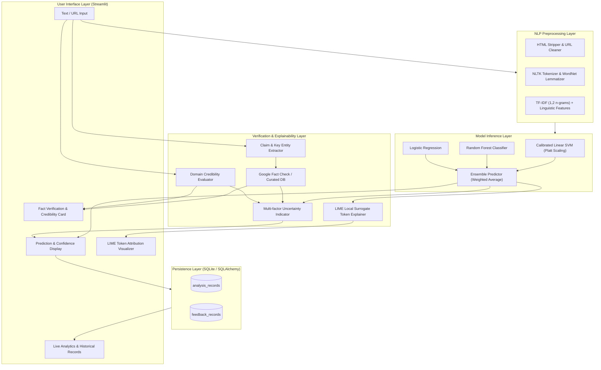

# System Architecture

## Overview

TruthLens AI implements a modular, multi-tier architecture combining machine learning, natural language processing, explainable AI, external fact verification, and persistent analytical storage.

## Architectural Layers

### 1. NLP Preprocessing Layer (`src/preprocessing/`)
- **Text Cleaner**: Strips HTML tags, Unicode normalisation (NFC), scrubs URLs, removes disruptive punctuation while optionally maintaining apostrophes, collapses multi-spaces.
- **Tokenizer**: Lemmatises tokens using WordNet and removes language-specific stopwords.
- **Feature Extractor**: Produces sublinear TF-IDF matrices (top 10,000 unigrams/bigrams) concatenated with hand-crafted scaled linguistic indicators (character counts, word counts, capitalisation ratios, exclamation marks).

### 2. Multi-Model ML Ensemble Layer (`src/ml/`)
- **Linear Support Vector Machine (LinearSVC)**: Fast, convex decision boundary with 3-fold Platt calibration via `CalibratedClassifierCV` to obtain probabilistic outputs.
- **Random Forest Classifier**: Ensemble of 100 decision trees to capture non-linear token interactions.
- **Logistic Regression**: Linear baseline with L2 penalty.
- **Ensemble Predictor**: Combines model probabilities into a single weighted score and discrete prediction label.

### 3. Verification & Credibility Layer (`src/verification/`)
- **Domain Reputation Engine**: Evaluates domain authority against curated lists (high credibility, low credibility, satire) alongside structural heuristics (subdomain depth, numerical patterns, institutional TLDs).
- **Claim Extractor**: Identifies declarative assertion sentences and extracts entity keywords.
- **Fact-Checker**: Queries Google Fact Check Tools API with fallback against an offline curated knowledge base of debunked misinformation claims.

### 4. Explainable AI & Uncertainty Layer (`src/explainability/`)
- **LIME Explainer**: Fits an interpretable local linear surrogate model on perturbed text instances to calculate signed feature weights for tokens pushing towards FAKE or REAL.
- **Uncertainty Evaluator**: Computes an aggregate uncertainty index considering prediction margin, inter-model discordance, text length sufficiency, and conflict with verified fact-checks.

### 5. Persistence Layer (`src/database/`)
- SQLite database managed via SQLAlchemy ORM with thread-safe connection pooling storing every analysed article, confidence score, fact-check verdict, and user correction.
